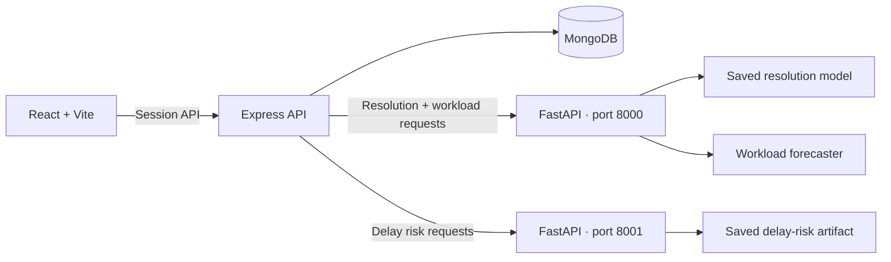
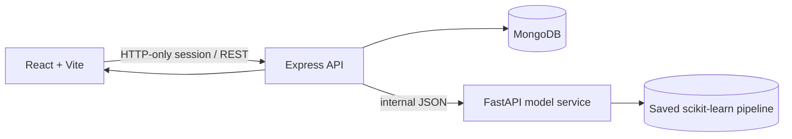

<<<<<<< HEAD
# OpsPilot AI

**A role-based help-desk operations workspace that carries customer and IT tickets through AI-assisted triage, resolution estimates, and workload planning.**

OpsPilot connects a React workspace, an Express API, MongoDB, and two isolated FastAPI model runtimes. Customers and IT Team members submit scoped tickets; admins review and assign them, inspect delay-risk and resolution signals, and refresh a linked ticket's workload outlook from recent history.

## What is implemented

- Customer, IT Team, and Admin roles with server-enforced ticket ownership, assignment scopes, replies, status/priority controls, attachments, recommendation decisions, and audit entries.
- Ticket creation-time scoring using the saved delay-risk classifier and resolution-time regressor; admins can run a single ordered risk → resolution → workload pipeline for an existing ticket.
- Live 7- or 14-day workload forecasts from refreshed ticket-level or daily aggregate CSV data; the resulting outlook is saved back to the linked ticket.
- Admin user/role management, dashboards, analytics, prediction history, and capacity scenarios comparing entered baseline/proposed tickets-per-day against saved forecasts.

## Architecture



Ticket and integrated-pipeline requests go through Express; completed model outputs and ticket changes are stored in MongoDB. The standalone workload page still calls the main ML service directly. See [`docs/ARCHITECTURE.md`](docs/ARCHITECTURE.md) and [`docs/API.md`](docs/API.md).

## Quick start — Windows PowerShell

Prerequisites: Node.js 20 or newer, Python 3.12, and MongoDB. Docker Desktop is an easy way to run the local database; an existing MongoDB instance also works.

```powershell
# From the repository root
py -3.12 -m venv .venv
.\.venv\Scripts\Activate.ps1
python -m pip install --upgrade pip
python -m pip install -r ml\requirements.txt
npm run install:all
py -3.12 -m venv .venv-delayrisk
.\.venv-delayrisk\Scripts\python.exe -m pip install --upgrade pip
.\.venv-delayrisk\Scripts\python.exe -m pip install -r ml\requirements-delay-risk.txt
Copy-Item server\.env.example server\.env
Copy-Item client\.env.example client\.env
```

Set a unique `SESSION_SECRET` in `server/.env` before signing in. Keep `.env` files local; never commit credentials. Start MongoDB and then run from the repository root:

```powershell
npm run db:up
npm run dev
```

`npm run db:up` starts a local MongoDB container and waits for its health check. The database port is bound to localhost only. `npm run db:down` stops it without deleting saved data.

Set `ADMIN_EMAILS` in `server/.env` before registering the Admin account. The services use ports 8000 (resolution/workload), 8001 (delay risk), 5000 (Express), and 5173 (Vite). Open `http://localhost:5173`.

For separate terminals or troubleshooting, use the exact instructions in [`docs/LOCAL_SETUP.md`](docs/LOCAL_SETUP.md).

## Model evidence and limitations

- **Resolution time:** the included notebook reports chronological held-out test MAE 692.21 hours, RMSE 1,215.48 hours, and R² -0.0982 on 9,877 rows. MAE is 678.95 hours lower than the saved median-baseline MAE (1,371.16 hours), while negative R² indicates worse squared-error performance than a mean predictor. Treat the estimate as experimental planning context, not an SLA promise.
- **Workload:** the notebook/report contains offline walk-forward evaluation on historical data. The live upload endpoint refits an XGBoost top-configuration ensemble on the submitted history. Its returned ranges are variability-based planning estimates, not calibrated 90% intervals; arbitrary uploaded data has no established accuracy claim.
- **Capacity scenarios:** Admins enter baseline/proposed daily ticket capacity. The scenario compares daily forecast demand with those values and tracks uncovered tickets; it is arithmetic planning support, not an inferred staffing recommendation or causal savings estimate.
- **Delay risk:** the saved classifier runs in an isolated scikit-learn 1.6.1 service. Its historical target is resolution taking over 720 hours; its review threshold emphasizes recall. Complaint text is context, not a model feature, and the score is not an SLA guarantee.
- The ZIP includes no raw dataset, and the separate newer forecasting notebook mentioned in the project brief is not included. The repository's original workload notebook is present.

See [`docs/ML_MODEL_INVENTORY.md`](docs/ML_MODEL_INVENTORY.md) for the input/output contracts and [`docs/PROJECT_AUDIT.md`](docs/PROJECT_AUDIT.md) for verified gaps.
=======
# OpsPilot AI — Predictive Business Operations Intelligence & Decision Engine

> **Predict problems. Explain risks. Optimise decisions. Measure impact.**

OpsPilot AI is an AI-powered business operations intelligence platform designed to help organisations identify operational bottlenecks, predict potential delays, prioritise critical tasks, and recommend feasible actions based on urgency, workload, and business impact.

Instead of simply displaying business analytics, OpsPilot AI combines machine learning, explainable predictions, and decision optimisation to help operations managers make better-informed decisions.

**Project type:** AI/ML + Full-Stack Development + Decision Optimisation  
**Status:** In development  
**Team size:** 3 members

---

## Table of Contents

1. [Problem Statement](#1-problem-statement)
2. [Our Solution](#2-our-solution)
3. [Key Features](#3-key-features)
4. [Dataset](#4-dataset)
5. [System Architecture](#5-system-architecture)
6. [Technology Stack](#6-technology-stack)
7. [Machine Learning Approach](#7-machine-learning-approach)
8. [Decision Optimisation Engine](#8-decision-optimisation-engine)
9. [Application Workflow](#9-application-workflow)
10. [Project Structure](#10-project-structure)
11. [Installation and Setup](#11-installation-and-setup)
12. [Environment Configuration](#12-environment-configuration)
13. [API Design](#13-api-design)
14. [Evaluation and Performance Metrics](#14-evaluation-and-performance-metrics)
15. [Team Responsibilities](#15-team-responsibilities)
16. [Development Roadmap](#16-development-roadmap)
17. [Deployment](#17-deployment)
18. [Limitations and Future Scope](#18-limitations-and-future-scope)
19. [Responsible AI and Data Integrity](#19-responsible-ai-and-data-integrity)
20. [Dataset Attribution](#20-dataset-attribution)

---

## 1. Problem Statement

Modern businesses generate large amounts of operational data through customer support requests, task management systems, internal workflows, and service operations.

However, identifying recurring problems, predicting delays, balancing workloads, and choosing the best operational action can require significant manual effort.

Traditional dashboards primarily show what has already happened. Basic predictive systems may identify potential problems but often fail to explain what action should be taken next.

This creates several challenges:

- Operational bottlenecks remain undetected until they affect performance.
- Important tasks may not receive attention at the right time.
- Workloads can become unevenly distributed.
- Managers lack evidence-backed recommendations for prioritising work.
- Proposed process improvements are difficult to evaluate against existing practices.

### Our objective

Build an intelligent decision-support system that transforms operational data into actionable recommendations.

OpsPilot AI aims to answer five questions:

1. What is going wrong?
2. Which tasks are likely to experience delays?
3. Why are these tasks at risk?
4. What action should be taken, considering operational constraints?
5. Does the proposed action perform better than the existing approach?

---

## 2. Our Solution

OpsPilot AI combines four major capabilities into one platform.

### 2.1 Operational Intelligence

Analyse historical operational records to identify recurring delays, workload imbalances, and process bottlenecks.

### 2.2 Predictive Intelligence

Use machine learning to estimate the risk of delayed ticket resolution and, if supported by the dataset, predict resolution time.

### 2.3 Decision Optimisation

Use an optimisation engine to recommend task priorities and feasible assignments based on risk, urgency, available capacity, and skill requirements.

### 2.4 Explainability and Impact Evaluation

Explain the factors behind predictions and compare the proposed decision policy against a baseline using consistent evaluation conditions.

**Core idea:**

`Analyse → Predict → Explain → Optimise → Evaluate`

The initial implementation focuses on customer support operations using help-desk ticket data. The architecture can later be extended to inventory management, workforce planning, and supply-chain operations.

---

## 3. Key Features

### Operational Dashboard

- Total open and resolved tickets.
- High-risk ticket overview.
- Resolution-time and workload analytics.
- Operational trend visualisations.
- Filters for priority, category, status, and assignee where the dataset supports them.

### Ticket Risk Prediction

- Estimate the likelihood of a ticket exceeding a defined resolution-time target.
- Identify high-risk tasks for early intervention.
- Compare a simple baseline model with more advanced algorithms.

### Bottleneck Analysis

- Analyse recurring delays across categories and workflow stages.
- Identify patterns associated with longer resolution times.
- Highlight potential workload imbalances.

### Explainable Predictions

- Display the predicted risk and important contributing factors.
- Use feature-based reason codes or SHAP explanations where appropriate.
- Clearly distinguish model estimates from verified facts.

### Decision Optimisation

- Prioritise tasks using urgency, predicted risk, and business impact.
- Respect assignment eligibility, skills, and capacity constraints when those inputs are available.
- Generate a proposed operational plan.
- Flag infeasible assignments rather than silently violating constraints.

### Baseline vs Proposed Plan

- Compare the existing prioritisation policy with the proposed policy.
- Evaluate weighted overdue work, workload balance, and constraint violations.
- Show the assumptions and limitations of any simulation.

### Human-in-the-Loop Decisions

- Allow managers to review proposed recommendations.
- Record approval or rejection in the application.
- Preserve a history of proposed actions and decisions.

> Actual ticket reassignment requires integration with an authorised ticketing system. Until that integration exists, the prototype will demonstrate recommendations and simulated outcomes.

---

## 4. Dataset

### Primary Dataset: Help Desk Tickets

**Source:** Mendeley Data

**Dataset link:** https://data.mendeley.com/datasets/btm76zndnt/3

The dataset release describes help-desk records and related workflow information. The downloadable files and their exact schemas must be inspected before finalising the prediction targets.

### Why this dataset?

It is a suitable starting point for investigating operational delays because help-desk workflows can involve ticket priorities, timestamps, assignment changes, and resolution outcomes.

These records may support:

- Resolution-time analysis.
- Historical bottleneck identification.
- Ticket risk modelling.
- Workflow and assignment analysis.
- Decision-policy simulation.

### Dataset preparation

The data pipeline will:

1. Download and inspect the dataset documentation.
2. Identify the available files, columns, data types, and missing values.
3. Understand how ticket creation, updates, assignment, and resolution are represented.
4. Remove duplicates and handle missing or inconsistent values.
5. Construct a prediction target only when the available data supports a defensible definition.
6. Create training, validation, and test sets using a time-aware split where appropriate.
7. Preserve the original data and document all transformations.

### Important dataset limitations

The source dataset must not be assumed to contain every field required by the complete system.

In particular, we must verify whether it provides:

- A defensible SLA deadline or resolution-time threshold.
- Reliable creation and resolution timestamps.
- Historical status and assignment information.
- Sufficient features available at prediction time.
- Employee capacity and skill information.

If workforce capacity or skill information is unavailable, we will create a separate, explicitly labelled configuration for simulation. Simulated data will not be represented as real historical information.

### Target definition

The primary prediction target will be finalised after inspecting the dataset.

A possible target is:

`delayed = 1 if actual_resolution_time > defined_resolution_time_threshold, otherwise 0`

This definition is appropriate only if the required timestamps and threshold can be established reliably. If actual SLA deadlines are available, SLA breach prediction may be preferable.

The prediction target, threshold, exclusions, and assumptions will be documented before training.

### Data leakage prevention

Features that become available only after a ticket is resolved must not be used to predict its earlier risk.

For example, final resolution time, final status, and future assignment changes must be excluded from a prediction made at ticket creation unless the prediction time is explicitly defined otherwise.

---

## 5. System Architecture

The application follows a modular architecture separating the user interface, API layer, intelligence engine, decision engine, and database.



The browser calls only Express. MongoDB and the model artifact are server-side concerns. The API saves a prediction only after it validates the model response; model failures never become fake results.

## Stack and structure

| Service | Stack | Responsibility |
| --- | --- | --- |
| `client` | React, TypeScript, Vite, Recharts, Framer Motion, Lucide | Marketing site and workspace UI |
| `server` | Node.js, Express, TypeScript, Mongoose, Argon2id | Auth, persistence, validation, orchestration |
| `ml` | Python, FastAPI, pandas, scikit-learn, joblib | Load the real pipeline and return estimates |
| Database | MongoDB | Users, sessions, and prediction history |

```text
Minimise:
    Total weighted operational risk
    + Estimated delay cost
    + Workload imbalance penalty

Subject to:
    Assignment eligibility
    Capacity constraints
    Required skill constraints
    Valid task allocation rules
```

The actual mathematical objective and constraints will be documented in the implementation.

### Optimisation approach

1. Implement a transparent baseline prioritisation policy.
2. Implement a feasible heuristic for task allocation.
3. Add Google OR-Tools when the required variables and constraints are defined.
4. Generate a proposed plan.
5. Validate every assignment against hard constraints.
6. Compare the baseline and proposed plans under the same scenario.

If the data does not provide reliable assignment-dependent outcomes, the prototype will clearly label its estimated benefits as simulation results rather than proof of real-world improvement.

---

## 9. Application Workflow

The typical user journey is:

1. **Open dashboard:** Review current operational status and KPIs.
2. **Load data:** Use the prepared dataset or upload a supported CSV.
3. **Analyse operations:** Explore ticket categories, delays, and workload patterns.
4. **Predict risk:** Run the trained model on eligible records.
5. **Review explanations:** Inspect the factors contributing to high-risk predictions.
6. **Generate a plan:** Request a prioritisation or assignment recommendation.
7. **Validate constraints:** Ensure the proposed plan respects the defined rules.
8. **Compare policies:** Evaluate baseline and proposed plans on the same scenario.
9. **Review and approve:** Record the manager's decision.
10. **Inspect history:** View saved predictions, recommendations, and evaluation results.

---

## 10. Project Structure

The following is the proposed repository structure. Files can be added as implementation progresses.

```text
opspilot-ai/
│
├── frontend/
│   ├── src/
│   │   ├── components/
│   │   ├── pages/
│   │   ├── services/
│   │   ├── hooks/
│   │   ├── types/
│   │   └── App.tsx
│   ├── package.json
│   └── vite.config.ts
│
├── backend/
│   ├── main.py
│   ├── schemas.py
│   ├── dependencies.py
│   ├── routers/
│   │   ├── health.py
│   │   ├── tickets.py
│   │   ├── predictions.py
│   │   ├── recommendations.py
│   │   └── evaluations.py
│   ├── services/
│   ├── models/
│   └── database/
│
├── ml/
│   ├── data_preprocessing.py
│   ├── feature_engineering.py
│   ├── train.py
│   ├── predict.py
│   ├── evaluate.py
│   └── artifacts/
│
├── optimizer/
│   ├── baseline.py
│   ├── constraints.py
│   ├── allocate.py
│   ├── simulator.py
│   └── evaluate.py
│
├── data/
│   ├── raw/
│   ├── processed/
│   └── README.md
│
├── tests/
│   ├── test_api.py
│   ├── test_predictions.py
│   ├── test_optimizer.py
│   └── test_data_validation.py
│
├── .env.example
├── .gitignore
├── requirements.txt
├── Dockerfile
├── docker-compose.yml
└── README.md
```

**Data policy:** Raw datasets, secrets, `.env` files, and unnecessary generated artefacts should not be committed to GitHub. Document the download instructions and required local paths instead.

---

## 11. Installation and Setup

### Prerequisites

Install:

- Python 3.11 or another version compatible with the pinned dependencies.
- Node.js and npm.
- Git.
- PostgreSQL, or Docker if using a containerised local database.

### Step 1: Clone the repository

```bash
git clone <YOUR_GITHUB_REPOSITORY_URL>
cd opspilot-ai
```

Replace the placeholder with the actual repository URL.

### Step 2: Create the Python environment

```bash
python -m venv .venv
```

Activate it on Windows PowerShell:

```powershell
node -e "console.log(require('crypto').randomBytes(48).toString('base64url'))"
```

Put it in `server/.env` as `SESSION_SECRET`. Local defaults are:

```dotenv
# server/.env
NODE_ENV=development
PORT=5000
CLIENT_ORIGIN=http://localhost:5173
MONGODB_URI=mongodb://127.0.0.1:27017/opspilot
ML_SERVICE_URL=http://127.0.0.1:8000
COOKIE_SECURE=false
ML_ARTIFACT_DIR=../ml/artifacts/resolution

# client/.env
VITE_API_BASE_URL=http://localhost:5000/api/v1
```

`.env` files are ignored by Git. See the service-specific examples for the complete variable list.

## Start locally

Start MongoDB first. A typical local PowerShell setup is:

```powershell
Get-Service *mongo*
Start-Service MongoDB
```

Then start all three application services from the root:

```powershell
npm run dev
```

This starts FastAPI at `http://localhost:8000`, Express at `http://localhost:5000`, and Vite at `http://localhost:5173`.

To start separately:

```powershell
./venv/Scripts/python.exe -m uvicorn ml.resolution_api:app --reload --port 8000
npm --prefix server run dev
npm --prefix client run dev
```

## Model contract

The existing `ml/resolution_predictor.py` is the source of truth. It requires exactly:

```json
{
  "issue_created": "2024-01-12T09:30:00Z",
  "issue_priority": "High",
  "issue_type": "Bug",
  "issue_proj": "C00d3dzwj28av.ew8x3"
}
```

It derives `created_year`, `created_month`, `created_dayofweek`, `created_hour`, `created_dayofmonth`, and `created_is_weekend` from `issue_created`. No resolution date, final status, future assignment, or other post-resolution field is accepted. FastAPI `/metadata` reads the saved pipeline's actual categories and provides them to React.

The response shape is:

```json
{
  "model_id": "resolution-time",
  "duration": 882.58,
  "unit": "hours",
  "prediction_type": "point_estimate",
  "model_version": "2026-10-26T06:21:01.513056+00:00"
}
```

The number above documents the shape only. The app never displays it as a sample result; real result cards use the current model response.

## API

Routes are under `/api/v1` and use `{ success, data, message }` responses. Authenticated routes use the HTTP-only `ops_session` cookie.

| Method | Route | Auth | Purpose |
| --- | --- | --- | --- |
| GET | `/health` | No | Liveness |
| GET | `/health/ready` | No | MongoDB and model readiness |
| POST | `/auth/signup` | No | Create user and session |
| POST | `/auth/login` | No | Authenticate user |
| POST | `/auth/logout` | No | Invalidate current session |
| GET | `/auth/me` | Cookie | Restore session |
| GET/PATCH | `/users/me` | Cookie | Read/update profile |
| PATCH | `/users/me/preferences` | Cookie | Save theme preference |
| GET | `/dashboard/summary` | Cookie | User-scoped KPIs |
| GET | `/dashboard/activity` | Cookie | User-scoped trends and activity |
| GET | `/models` | Cookie | Registry and health status |
| GET | `/models/:modelId` | Cookie | One registry entry |
| GET | `/models/resolution-time/metadata` | Cookie | Verified schema and metrics |
| POST | `/predictions/resolution-time` | Cookie | Infer, validate, and persist |
| GET | `/predictions` | Cookie | Paginated user history |
| GET | `/predictions/:id` | Cookie | Owned prediction detail |
| DELETE | `/predictions/:id` | Cookie | Delete owned record |

Full examples are in [`docs/API.md`](docs/API.md).

## Historical evaluation evidence

The UI reads `ml/artifacts/resolution/metrics.json`. The untouched chronological test split contains 9,877 rows:

- MAE: `692.2123` hours.
- RMSE: `1215.4779` hours.
- R²: `-0.0982`.

These values describe the saved experiment, not live accuracy. The negative R² indicates performance below a mean-prediction reference under that reported evaluation. The model is experimental and does not guarantee an SLA or resolution outcome.

## Security notes

- Passwords are hashed with Argon2id and never returned.
- Sessions use random opaque tokens stored as HMAC hashes in MongoDB.
- Cookies are HTTP-only, same-site, and configurable for secure transport.
- CORS and mutation origin checks use explicit `CLIENT_ORIGIN` values.
- Auth endpoints and API traffic are rate limited.
- History and detail queries are scoped to the authenticated user.
- Request payloads are validated with Zod before orchestration.
- Secrets, passwords, tokens, and headers are not logged.
>>>>>>> origin/main

## Checks

```powershell
npm --prefix server run build
npm --prefix server test
<<<<<<< HEAD
npm --prefix client run build
.\.venv\Scripts\python.exe -m unittest ml.test_resolution_api ml.test_workload_forecast
```

These commands check compilation and focused tests. End-to-end ticket and prediction workflows require MongoDB and both ML services; workload forecasts require refreshed history spanning at least 120 days. See [`docs/TEST_REPORT.md`](docs/TEST_REPORT.md) for verified results and remaining demo checks.
=======
npx --prefix client tsc -b --pretty false
npm --prefix client run build
.\venv\Scripts\python.exe -m unittest ml.test_resolution_api
```

The end-to-end prediction flow additionally requires MongoDB, FastAPI, and Express to be running.

## Troubleshooting

```powershell
Invoke-RestMethod http://localhost:5000/api/v1/health
Invoke-RestMethod http://localhost:8000/health
Invoke-RestMethod http://localhost:5000/api/v1/health/ready
```

If readiness returns 503, verify `MONGODB_URI`, `ML_SERVICE_URL`, and `ML_ARTIFACT_DIR`. A missing artifact is reported as unavailable; the app does not substitute a fake model. For port conflicts:

```powershell
Get-NetTCPConnection -LocalPort 5000,5173,8000 -ErrorAction SilentlyContinue
Stop-Process -Id <PID>
```

On machines where Application Control blocks Rollup's native `.node` binary, the client TypeScript check still works with `npx --prefix client tsc -b --pretty false`; production bundling needs an approved Node/Vite dependency installation.

## Future model integration

The two provisional slots remain `coming_soon` until their real artifacts, input contracts, health checks, and evaluation evidence exist. Follow [`docs/ML_INTEGRATION_GUIDE.md`](docs/ML_INTEGRATION_GUIDE.md) to register a model without changing shared auth, history, navigation, or theme infrastructure.

## Related documentation

- [`docs/ARCHITECTURE.md`](docs/ARCHITECTURE.md) — service boundaries and data flow.
- [`docs/API.md`](docs/API.md) — implemented endpoint contracts.
- [`docs/ML_INTEGRATION_GUIDE.md`](docs/ML_INTEGRATION_GUIDE.md) — teammate integration contract.
>>>>>>> origin/main
